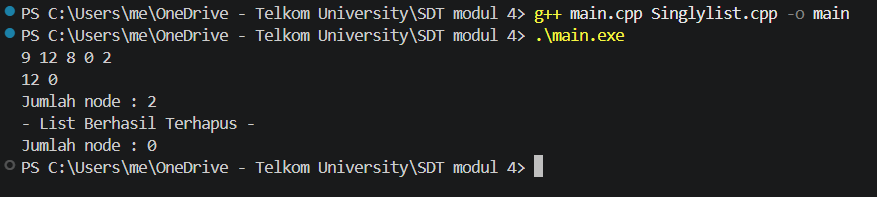

# <h1 align="center">Laporan Praktikum Modul 4 - Singly Linked List (Bagian Pertama)</h1>
<p align="center">Ignatius Steven Manurung - 109082500089</p>

## Dasar Teori
Singly Linked List merupakan struktur data linear dinamis yang terdiri dari sekumpulan elemen (node) yang saling terhubung secara searah menggunakan pointer. Setiap node dalam struktur ini memiliki dua komponen utama, yaitu bagian info untuk menyimpan nilai data dan bagian next yang menyimpan alamat memori (address) dari node berikutnya. Berbeda dengan array yang ukuran memorinya statis dan bersebelahan, alokasi memori pada linked list bersifat dinamis menggunakan operator new dan delete sesuai kebutuhan saat program berjalan. Keseluruhan rantai elemen ini diakses melalui satu pointer penunjuk awal bernama First yang mengarah ke node pertama, sementara pointer next pada node terakhir akan bernilai Nil (NULL) sebagai penanda akhir list. 

## Unguided 

### 1. singlylist.h

```C++
#ifndef SINGLYLIST_H
#define SINGLYLIST_H

#include <iostream>
using namespace std;

#define Nil NULL
#define info(P) (P)->info
#define next(P) (P)->next
#define first(L) ((L).First)

typedef int infotype;
typedef struct ElmList *address;

struct ElmList {
    infotype info;
    address next;
};

struct List {
    address First;
};

void createList(List &L);
address alokasi(infotype x);
void dealokasi(address &P);
void printInfo(List L);
void insertFirst(List &L, address P);

void deleteFirst(List &L, address &P);
void deleteLast(List &L, address &P);
void deleteAfter(List &L, address Prec, address &P);
int nbList(List L);
void deleteList(List &L);

#endif
```
### Output Unguided 1 :

##### Output 1


Pada file Singlylist.h, kode berfungsi sebagai definisi Abstract Data Type (ADT) yang mendeklarasikan struktur data ElmList sebagai cetakan node, tipe data List sebagai wadah pointer First, serta makro dan prototipe seluruh fungsi maupun prosedur yang akan digunakan. Penggunaan header guard (#ifndef dan #define) di bagian awal memastikan file tidak terkompilasi ganda saat dipanggil oleh file lain.

### 2. singlylist.cpp

```C++
#include "Singlylist.h"

void createList(List &L) {
    first(L) = Nil;
}

address alokasi(infotype x) {
    address P = new ElmList;
    info(P) = x;
    next(P) = Nil;
    return P;
}

void dealokasi(address &P) {
    delete P;
    P = Nil;
}

void printInfo(List L) {
    address P = first(L);
    while (P != Nil) {
        cout << info(P) << " ";
        P = next(P);
    }
    cout << endl;
}

void insertFirst(List &L, address P) {
    next(P) = first(L);
    first(L) = P;
}

void deleteFirst(List &L, address &P) {
    if (first(L) != Nil) {
        P = first(L);
        first(L) = next(P);
        next(P) = Nil;
    }
}

void deleteLast(List &L, address &P) {
    if (first(L) != Nil) {
        if (next(first(L)) == Nil) {
            deleteFirst(L, P);
        } else {
            address Q = first(L);
            while (next(next(Q)) != Nil) {
                Q = next(Q);
            }
            P = next(Q);
            next(Q) = Nil;
        }
    }
}

void deleteAfter(List &L, address Prec, address &P) {
    if (Prec != Nil && next(Prec) != Nil) {
        P = next(Prec);
        next(Prec) = next(P);
        next(P) = Nil;
    }
}

int nbList(List L) {
    int count = 0;
    address P = first(L);
    while (P != Nil) {
        count++;
        P = next(P);
    }
    return count;
}

void deleteList(List &L) {
    address P;
    while (first(L) != Nil) {
        deleteFirst(L, P);
        dealokasi(P);
    }
}
```
### Output Unguided 2 :

##### Output 1


Pada file Singlylist.cpp, kode berisi logika implementasi dari setiap primitif dasar yang telah dideklarasikan. Fungsi createList menginisialisasi list kosong dengan mengatur First menjadi Nil, sementara alokasi memesan ruang memori baru di heap untuk sebuah node dan dealokasi membebaskannya kembali agar tidak terjadi kebocoran memori (memory leak). Prosedur insertFirst menyisipkan node baru di posisi paling depan dengan mengarahkan next node baru ke First lama lalu memindahkan First ke node baru tersebut, sedangkan printInfo menelusuri list dari First hingga Nil untuk mencetak seluruh datanya. Untuk operasi penghapusan pada soal kedua, deleteFirst memutus dan memindahkan pointer First ke elemen kedua, deleteLast menelusuri list hingga satu node sebelum terakhir (next(next(Q)) == Nil) untuk memutus elemen paling ujung, dan deleteAfter menghapus node tepat setelah pointer acuan (Prec) dengan menyambungkan ulang pointer next agar rantai list tidak terputus. Selain itu, fungsi nbList menghitung total node melalui perulangan hingga ujung list, dan deleteList mengosongkan seluruh isi list dengan memanggil deleteFirst beserta dealokasi secara berulang sampai First kembali bernilai Nil.

### 3. main.cpp

```C++
#include "Singlylist.h"

int main() {
    List L;
    address P1, P2, P3, P4, P5 = Nil;
    address Pdel;

    createList(L);

    P1 = alokasi(2);
    insertFirst(L, P1);

    P2 = alokasi(0);
    insertFirst(L, P2);

    P3 = alokasi(8);
    insertFirst(L, P3);

    P4 = alokasi(12);
    insertFirst(L, P4);

    P5 = alokasi(9);
    insertFirst(L, P5);

    printInfo(L);

    deleteFirst(L, Pdel);
    dealokasi(Pdel);

    deleteLast(L, Pdel);
    dealokasi(Pdel);

    deleteAfter(L, first(L), Pdel);
    dealokasi(Pdel);

    printInfo(L);
    cout << "Jumlah node : " << nbList(L) << endl;

    deleteList(L);
    cout << "- List Berhasil Terhapus -" << endl;
    cout << "Jumlah node : " << nbList(L) << endl;

    return 0;
}
```
### Output Unguided 3 :

##### Output 1


Pada file main.cpp, program utama mengeksekusi alur pengujian sesuai instruksi modul dengan mula-mula membuat list kosong dan memasukkan angka 2, 0, 8, 12, serta 9 secara berurutan menggunakan insertFirst, sehingga menghasilkan susunan akhir terbalik yakni 9 12 8 0 2. Program kemudian melanjutkan eksekusi soal kedua dengan menghapus elemen terdepan (9) memakai deleteFirst, elemen terakhir (2) memakai deleteLast, dan elemen tengah (8) memakai deleteAfter dengan acuan First (node 12), sebelum akhirnya menampilkan sisa node (12 0), menghitung jumlahnya via nbList, dan menghapus seluruh sisa node menggunakan deleteList.

## Kesimpulan
Berdasarkan hasil praktikum dan implementasi program yang telah dilakukan, dapat disimpulkan bahwa struktur data Singly Linked List memungkinkan pengelolaan data secara dinamis menggunakan pointer untuk menghubungkan setiap node secara searah melalui info dan next. Pemisahan kode ke dalam konsep Abstract Data Type (ADT) melalui file .h dan .cpp membuat struktur program menjadi lebih modular, rapi, serta mempermudah pengelolaan operasi dasar seperti penambahan elemen (insertFirst) maupun penghapusan elemen di berbagai posisi (deleteFirst, deleteLast, dan deleteAfter). Selain itu, ketelitian dalam manipulasi pointer serta penggunaan fungsi dealokasi sangat krusial agar rantai antar-node tetap terhubung dengan benar saat terjadi penghapusan data dan tidak menimbulkan kebocoran memori (memory leak) pada sistem.

## Referensi
Cormen, T. H., Leiserson, C. E., Rivest, R. L., & Stein, C. (2022). Introduction to Algorithms (4th ed.). MIT Press.

Goodrich, M. T., Tamassia, R., & Mount, D. M. (2011). Data Structures and Algorithms in C++ (2nd ed.). John Wiley & Sons.

Malik, D. S. (2018). Data Structures Using C++ (2nd ed.). Cengage Learning.

Weiss, M. A. (2014). Data Structures and Algorithm Analysis in C++ (4th ed.). Pearson.